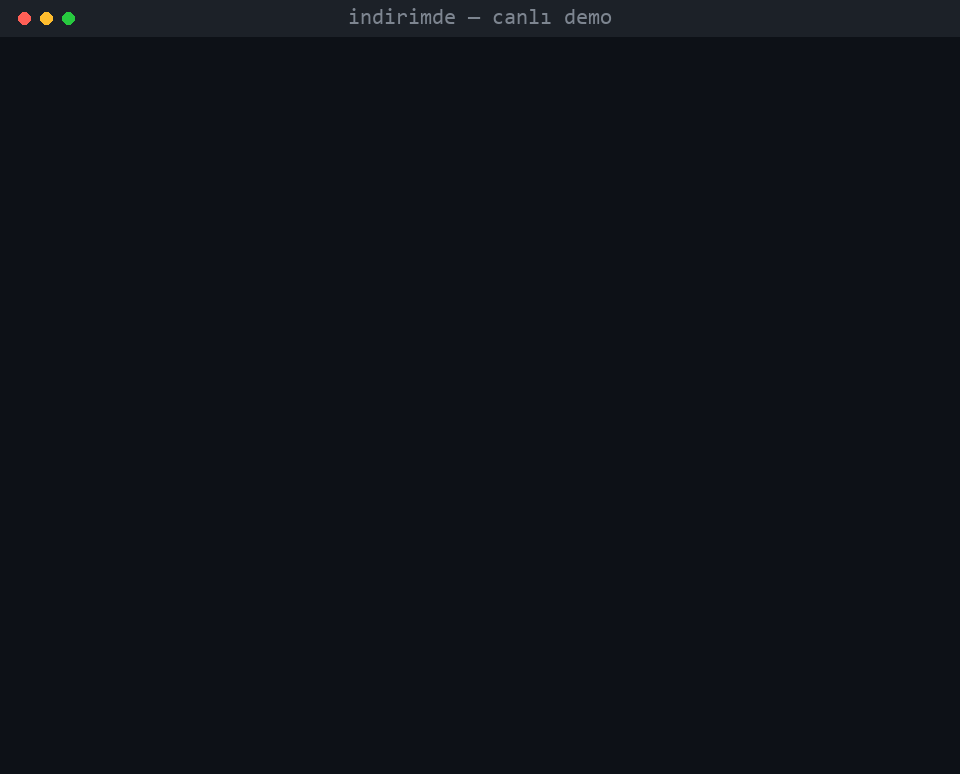
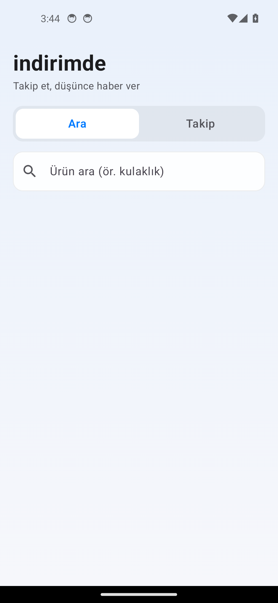

# indirimde

Takip ettiğin ürünün fiyatı düştüğünde telefonuna bildirim gönderen uygulama.
Uygulama içinden ürün ara, takibe al, indirime girince haber al.



> Yukarıdaki kayıt **canlı Trendyol'dan** alınmıştır: gerçek arama, gerçek
> fiyatlar, gerçek düşüş kararı (`719,00 TL → 699,00 TL`, %2.8). Uydurma veri yok.

## Nasıl çalışıyor

Üç parça var ve bilerek ayrık tutuldu:

- **Saf çekirdek** (`backend/indirimde/money.py`, `pricing.py`) — fiyatı tam
  sayı kuruş olarak tutar (float yok, `884,45 TL` = `88445`) ve "bu fiyat
  gerçekten düştü mü?" kararını verir. Ağ yok, aynı girdi hep aynı çıktı,
  tamamı testli.
- **Mağaza adaptörleri** (`backend/indirimde/stores/`) — dış dünyaya dokunan
  tek yer. Her mağazanın bir *parser*'ı (mağazanın verdiği yanıtı `Product`'a
  çevirir, testli) bir de *fetcher*'ı (o yanıtı gidip getiren kırılgan yarı)
  vardır. Fetcher **fail-closed** çalışır: fiyat okunamazsa fiyat uydurmaz,
  boş/`None` döner.
- **İzleyici** (`backend/indirimde/watcher.py`) — bir takibi yoklar: fiyatı
  okur, karar verir, tabanı günceller, düştüyse bildirir. Mağaza çökerse taban
  son gerçek fiyatta kalır; kesinti fiyat değişikliği sanılmaz.

Mağaza olarak Türkiye seçildi; ilk adaptör **Trendyol**. Trendyol düz sunucu
isteğini `403` ile reddediyor (bot koruması), bu yüzden arama sonucu gerçek bir
tarayıcıda render edilip sayfadaki gömülü JSON
(`window["__single-search-result__PROPS"].data`) alınır. Parser bu yapıyı
canlı siteden yakalanmış bir örneğe (`backend/fixtures/`) göre test edilir.

Fiyat anlamı: alıcının ödediği = `discountedPriceText` → takip edilen fiyat.
`old > 0` olduğunda çizili eski fiyat gösterim içindir.

## Durum

Bitti ve testli:
- Para tipi (TR fiyat parse, kuruş, Decimal yuvarlama).
- İndirim kararı (yüzde + mutlak eşik, kullanıcı başına kural).
- Trendyol arama parser'ı (gerçek yakalanmış veriye karşı).
- İzle → oku → karar → bildir akışı, mağaza kesintisine dayanıklı.
- Bildirim metni (Türkçe) ve taşıma arayüzü (FCM enjekte edilir).

- Trendyol canlı fetcher (Playwright ile tarayıcı render) — 403 engelini aşıp
  arama için gömülü JSON'u, fiyat için ürün sayfasının JSON-LD teklifini
  (`schema.org/Product` → `offers.price`) okur. JSON-LD kararlı sözleşmedir;
  sayfanın değişen özel React state'ine bağlı değildir.
- **FastAPI sunucusu** (`backend/indirimde/server/`) — ara, cihaz token kaydı,
  takibe al/çıkar, takip listesi uç noktaları; arka planda periyodik yoklama
  (asyncio zamanlayıcı); düşüşte **FCM** push.

Firebase gerektiren tek adım sende: `google-services.json` (istemci) +
servis hesabı JSON'u (sunucu). Yoksa sunucu yine uçtan uca çalışır — FCM
taşıması her push'u göndermek yerine loglar, böylece tüm akış (ara → takip →
yokla → düşüş kararı → render) Firebase'siz denenebilir.

## Sunucu (server + FCM)

```bash
cd backend
python -m pip install -r requirements.txt
python -m playwright install chromium
python -m indirimde.server.run        # http://0.0.0.0:8000
```

Uç noktalar: `POST /search`, `POST /devices`, `POST/DELETE /watches`,
`GET /watches?userId=`, `POST /poll` (elle tetik), `GET /health`.

Ayarlar (ortam değişkeni): `INDIRIMDE_PORT`, `INDIRIMDE_POLL_SECONDS`
(varsayılan 10800 = 3 saat), `INDIRIMDE_DATA` (JSON durum dosyası),
`INDIRIMDE_FCM_CREDENTIALS` / `GOOGLE_APPLICATION_CREDENTIALS` (servis hesabı).

FCM'i gerçekten göndermek için: Firebase projesi aç, bir servis hesabı anahtarı
indir, yolunu `INDIRIMDE_FCM_CREDENTIALS` ile ver. Anahtar depoya girmez
(`.gitignore`).

## Android uygulaması (v1, bağımsız)

`android/` altında Kotlin + Jetpack Compose uygulaması. Bu ilk sürüm **tek
başına** çalışır: sunucu ya da Firebase gerektirmez.




- Fiyatı telefonun kendisi kontrol eder. Trendyol'a düz istek 403 döndüğü için
  sayfayı gizli bir **WebView**'de render edip veriyi oradan okur (sunucudaki
  Playwright'ın mobil karşılığı): arama gömülü JSON'dan, fiyat yeniden-kontrolü
  ürün sayfasının DOM'undaki satış fiyatından.
- **WorkManager** 3 saatte bir arka planda kontrol eder; indirim eşiği (yüzde +
  mutlak) aşılınca **yerel bildirim** atar. Backend watcher'ın aynı mantığı:
  ilk okuma tabanı kurar, mağaza kesintisi fiyat değişikliği sanılmaz.
- Para/indirim çekirdeği backend'in Kotlin portu (kuruş, float yok).
- Apple tarzı cam arayüz; "Ara" ve "Takip" sekmeleri.

Kurulabilir APK: bu deponun **Releases** bölümünde.

Kaynaktan derleme (JDK 17 + Android SDK gerekir):

```bash
cd android
./gradlew assembleDebug
```

Not: Gradle/AGP proje yolunda ASCII olmayan karakteri reddeder; depoyu ASCII bir
yola koyup derle.

## Çalıştırma (backend testleri)

```bash
cd backend
python -m pip install -r requirements-dev.txt
python -m pytest -q
```

45 test, hepsi geçer (çekirdek + parser + watcher + sunucu/HTTP akışı).
